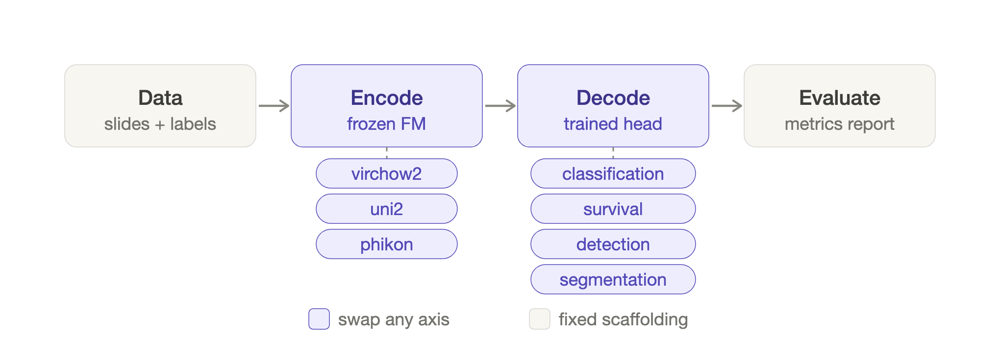

# soma

`soma` runs computational pathology experiments from images and labels to predictions, metrics, and reports. It combines preprocessing, frozen foundation-model features, and downstream training through a modular Python API or a YAML pipeline.

<p align="center">
  
</p>

**[Documentation](https://clemsgrs.github.io/soma)** · **[PyPI](https://pypi.org/project/soma-pathology/)**

## Install

Requires Python 3.11 or later:

```bash
pip install soma-pathology
```

The distribution is `soma-pathology`; the Python package and CLI are `soma`.

## Run an experiment

For slide classification, prepare `dataset.csv` (sample ID, image path, label) and `splits.csv` (sample ID, split, fold). The [getting started guide](https://clemsgrs.github.io/soma/getting-started.html) shows both files and a complete walkthrough.

```python
from soma import ExperimentConfig, Pipeline
from soma.config import (
    CohortConfig,
    EvaluationConfig,
    FeaturesConfig,
    LearnerConfig,
    RunConfig,
    TrainerConfig,
)

config = ExperimentConfig(
    run=RunConfig(output_dir="output", seed=0),
    cohort=CohortConfig(records="dataset.csv", splits="splits.csv"),
    features=FeaturesConfig(encoder="phikon"),
    learner=LearnerConfig("mil", {"aggregator": "abmil", "head": "binary_classification"}),
    trainer=TrainerConfig(max_epochs=5),
    evaluation=EvaluationConfig(metrics=["auroc", "balanced_accuracy"]),
)
result = Pipeline(config).run()
print(result.summary)
print(result.run_dir)
```

`phikon` weights are public and download on first use. To extract features once and reuse them across experiments, see the [API guide](https://clemsgrs.github.io/soma/api.html).

## Use the CLI

Run the same pipeline from a YAML config:

```bash
soma run config.yaml
# Equivalent:
python -m soma run config.yaml
```

Or start from a preset, a complete experiment for a common task (`soma list presets`):

```bash
soma run --preset mil_classification --encoder phikon --cohort dataset.csv --splits splits.csv --out output
# or print it as an editable YAML with every default filled in, edit it, then run it:
soma init mil_classification --encoder phikon > experiment.yaml
soma run experiment.yaml
```

The YAML has the same seven sections as `ExperimentConfig` (`run`, `cohort`, `features`, `loaders`, `learner`, `trainer`, `evaluation`), spelled as the Python call spells them; a field left out keeps its default. soma resolves the config against the cohort and writes the result to the run's `plan.yaml`. Start with the [task examples](examples/README.md) or the [CLI reference](https://clemsgrs.github.io/soma/cli.html). `soma list` prints the component kinds and `soma list aggregators` (or `encoders`, `heads`, `decoders`, `benchmarks`, ...) prints one kind's registered components with their params.

## Explore

- [How soma works](https://clemsgrs.github.io/soma/how-soma-works.html): pipeline components and experiment design.
- [Modeling paths](https://clemsgrs.github.io/soma/modeling.html): tile, slide, patient, and dense prediction workflows.
- [Tutorials](https://clemsgrs.github.io/soma/tutorials/index.html): task-specific walkthroughs.
- [Benchmarking](https://clemsgrs.github.io/soma/benchmarking.html): fixed protocols and encoder comparisons, including [task-free CRoMa evaluation](https://clemsgrs.github.io/soma/api.html#task-free-representation-evaluation).
- [Caching](https://clemsgrs.github.io/soma/caching.html) and [run outputs](https://clemsgrs.github.io/soma/outputs.html): feature reuse and experiment provenance.

## License

[Apache-2.0](LICENSE).
